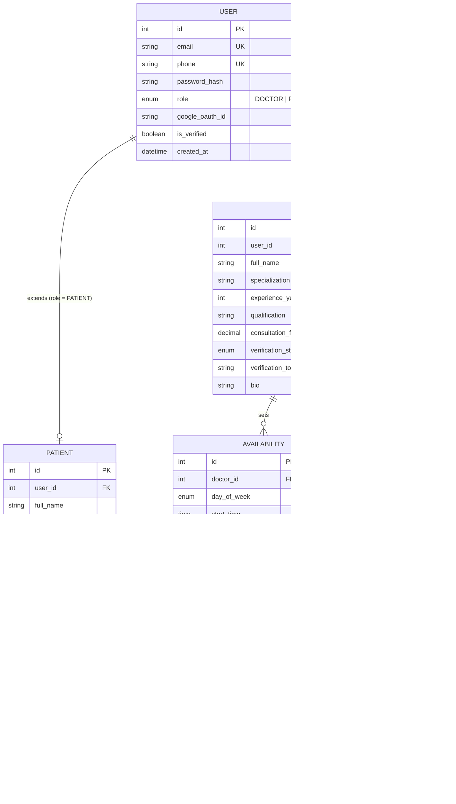

# Patient Management System — ER Diagram

Modules covered (in order): **User → Patient → Doctor → Availability → Appointment**

## Diagram

## Relationships Explained

| Relationship | Cardinality | Notes |
|---|---|---|
| User ↔ Patient | 1 : 0..1 | A user with role PATIENT has one patient profile |
| User ↔ Doctor | 1 : 0..1 | A user with role DOCTOR has one doctor profile |
| Doctor ↔ Availability | 1 : N | A doctor defines many availability windows (per weekday) |
| Patient ↔ Appointment | 1 : N | A patient can book many appointments |
| Doctor ↔ Appointment | 1 : N | A doctor can have many appointments |
| Availability ↔ Appointment | 1 : N | Appointments are booked against a slot window; `max_appointments` enables elastic scheduling |

## Design Notes

- **User** is the shared auth entity (email/phone/Google OAuth + role) — matches Week 1 auth endpoints (`/auth/signup`, `/auth/signin`, `/auth/signout`).
- **Patient** and **Doctor** extend User 1-to-1, keeping auth concerns separate from domain profiles.
- **Availability** is per doctor per weekday with `slot_duration_minutes` and `max_appointments` to support elastic scheduling (Week 3) — doctors can expand consulting hours and capacity.
- **Appointment** links patient, doctor, and the availability slot it was booked into; `status` covers the booking → confirm → cancel/reschedule lifecycle (Weeks 2–3).
